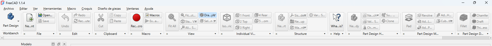
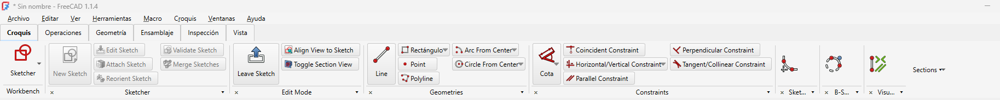
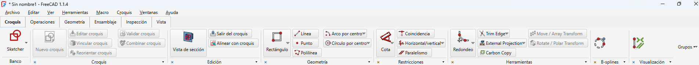

# NeoRibbon – SolidWorks Experience

Fork de [NeoRibbon](https://github.com/robdevtech/NeoRibbon) para ofrecer en
**FreeCAD 1.1.4** una interfaz y un flujo de trabajo similares a SolidWorks,
sin modificar el núcleo de FreeCAD y preservando las funciones del complemento
original. **Versión actual: 0.4.3.**

La cinta utiliza las APIs públicas de FreeCAD y widgets Qt. No requiere paquetes
Python externos para funcionar ni una biblioteca de cinta de terceros.

## Antes y después

### Antes: NeoRibbon original

Cinta en el banco Part Design, con grupos en una única tira horizontal,
etiquetas truncadas y nombres heredados de las barras originales.



### Antes de la corrección de Croquis

Primera organización por categorías en Sketcher: nombres en español e inglés,
un grupo de restricciones muy ancho y títulos como «Sket…», «B-S…» y «Visu…».



### Después: versión 0.4.2

Cinta en Sketcher con seis categorías, nombres de grupos completos, traducción
de etiquetas habituales y un grupo de restricciones más compacto. Las demás
herramientas siguen accesibles desde los desplegables.



Las capturas son reales de FreeCAD 1.1.4. La primera muestra Part Design;
las dos siguientes muestran Sketcher y permiten comparar la corrección de Croquis
en el mismo banco. Algunas etiquetas de herramientas secundarias conservan los
nombres proporcionados por FreeCAD o por sus complementos.

## Cambios implementados

### Interfaz y distribución

- Etiquetas completas en los botones, sin recorte arbitrario por caracteres.
- Alturas calculadas según la fuente, los iconos y la densidad elegida.
- Espaciado y alineación más coherentes entre botones y columnas.
- Grupos adaptables al ancho: los últimos se convierten en botones compactos
  cuando falta espacio y se expanden al ampliar la ventana.
- Acceso a todos los comandos desde el pie del grupo o su botón compacto.
- Desplazamiento horizontal disponible para ventanas muy estrechas.
- Ancho reservado para los títulos completos, incluso en grupos compactos.
- Colores basados en la paleta y los tokens de FreeCAD, con actualización al
  cambiar de tema claro u oscuro.

### Seis categorías de trabajo

| Categoría | Herramientas agrupadas |
| --- | --- |
| Croquis | Creación y edición de croquis, geometría, restricciones, herramientas y ayudas de Sketcher |
| Operaciones | Operaciones de Part Design y operaciones reconocidas de Part, como extrusión, revolución y acabados |
| Geometría | Referencias, geometría auxiliar y herramientas de Part y Draft |
| Ensamblaje | Comandos reconocidos de Assembly y algunos complementos de ensamblaje |
| Inspección | Medición y validación disponibles en el banco activo |
| Vista | Orientación, visualización, comandos generales y herramientas no clasificadas |

La cinta muestra **los comandos del banco de trabajo activo**. Cambiar de
categoría no activa otros bancos ni carga sus herramientas en segundo plano.
Los comandos desconocidos permanecen accesibles en Vista.

Los comandos fijados tienen prioridad. El resto se selecciona según prioridades,
frecuencia de uso y orden original. En Personalizado se conserva el orden de
comandos definido por el usuario, después de los fijados.

### Croquis e Inspección

- Nombres claros para grupos conocidos: **Croquis, Edición, Geometría,
  Restricciones, Herramientas, B-splines y Visualización**.
- Traducción de comandos habituales como Nuevo croquis, Editar croquis,
  Salir del croquis, Coincidencia, Paralelismo y Medir.
- En SolidWorks, los grupos de restricciones muestran hasta **cuatro comandos**,
  además de cualquier fijado que supere ese límite. El desplegable mantiene
  la lista completa.
- En Inspección, los grupos se identifican como **Medición** o **Validación**,
  conservando las claves de configuración de sus barras de origen.
- Los estados habilitado, marcado y los cambios de icono se sincronizan con las
  acciones originales. Un comando deshabilitado por FreeCAD permanece
  deshabilitado en la cinta.

### Botón de acceso rápido: Extruir (0.4.3)

En el banco **Sketcher**, encontrarás **Extruir** al principio de la pestaña
**Croquis**, dentro del grupo **Crear sólido**. Permite pasar del croquis a una
extrusión sin salir de la edición y cambiar de banco manualmente.

1. Crea o edita un croquis dentro de un **Cuerpo de Part Design**.
2. Pulsa **Croquis → Crear sólido → Extruir**.
3. NeoRibbon termina la edición con el comando nativo, activa **Part Design**,
   selecciona ese mismo croquis y abre **Pad**.
4. Elige la longitud y confirma en el panel de FreeCAD.

También funciona con un único croquis seleccionado fuera de edición. El botón
queda deshabilitado si el croquis no pertenece a un Cuerpo de Part Design o
la selección es incompatible. FreeCAD conserva sus comprobaciones del perfil
y su diálogo de extrusión; el botón no crea ni mueve cuerpos automáticamente.

La captura de después corresponde a 0.4.2 y todavía no muestra este botón.

### Perfiles y personalización

| Perfil | Comportamiento |
| --- | --- |
| SolidWorks | Cinta con las seis categorías y distribución adaptable |
| FreeCAD clásico | Desactiva la cinta y restaura las barras nativas usando la instantánea existente |
| Personalizado | Permite ordenar grupos y comandos, crear grupos, mover comandos entre grupos y cambiar su categoría |

- Configuración persistente por perfil: densidad, etiquetas, cantidad de comandos
  visibles, modo de comandos compuestos, barras ignoradas, grupos ocultos,
  fijados y orden de secciones.
- Distribuciones personalizadas guardadas por banco de trabajo.
- Editor sobre una copia provisional: **Guardar** activa Personalizado;
  **Cancelar** descarta sus cambios.
- Selección de perfil en preferencias aplicada al pulsar **Aplicar/Aceptar**.
- Restauración independiente del perfil activo, con **Deshacer**, disponible
  también después de reiniciar.
- Conservación de títulos personalizados y acceso a comandos nuevos del banco
  al cargar una distribución guardada.

Los atajos y la instantánea de barras clásicas son compartidos entre perfiles.
Los botones **Personalizar** y **Restaurar perfil** son acciones explícitas:
guardar el editor o pulsar restaurar tiene efecto inmediato. Restaurar un perfil
es distinto de la recuperación de emergencia de barras clásicas.

### Carga, recuperación y publicación

- Paquete independiente **`freecad.NeoRibbonSolidWorks`** para evitar que el fork
  importe módulos de una instalación del NeoRibbon original.
- Identidad y versión diferenciadas en `package.xml` y `pyproject.toml`.
- Construcción de la cinta antes de ocultar las barras clásicas.
- Recuperación de barras y registro de la excepción completa si falla la
  activación o la actualización desde preferencias.
- URLs del repositorio, README e incidencias corregidas para apuntar al fork.
- Rama **`solidworks-experience`** publicada para resolver el 404 del README
  solicitado por Addon Manager.

## Funciones originales conservadas

- Activación y desactivación de la cinta sin reiniciar FreeCAD.
- Densidades pequeña, mediana y grande; etiquetas e icono grande opcionales.
- Comandos compuestos anidados en desplegables o listados individualmente.
- Fijados, contadores locales de uso, ocultación y orden de grupos.
- Atajo editable de activación, con detección de conflictos.
- Listas completas con acceso a la ayuda de los comandos.
- Restauración de visibilidad, distribución, opciones y barras flotantes mediante
  la instantánea existente.
- Restauración al desactivar o desinstalar; control de barras creadas tardíamente
  por otros bancos y recuperación de las barras antes de guardar el estado al salir.

No se modifica el núcleo de FreeCAD. Las preferencias de NeoRibbon existentes
se conservan y no se envían datos de uso fuera del equipo.

## Instalación

Requisitos: FreeCAD 1.1.4 como versión objetivo, Python 3.10 o posterior y el
envoltorio PySide/Qt suministrado por FreeCAD. No es necesario instalar PySide6
con pip para utilizar el complemento.

### Addon Manager

1. Abre **Herramientas → Administrador de complementos**.
2. Agrega o configura este repositorio:

   | Campo | Valor |
   | --- | --- |
   | Repositorio | `https://github.com/dani71153/NeoRibbon-SolidWorks` |
   | Rama | `solidworks-experience` |

3. Desactiva NeoRibbon original si está instalado, para utilizar una sola cinta.
4. Instala o actualiza el fork y **reinicia FreeCAD**.

La rama `master` conserva la versión original; las mejoras se publican en
`solidworks-experience`. Si aparece un 404, verifica la rama y actualiza la
información del repositorio en Addon Manager. El [README publicado](https://raw.githubusercontent.com/dani71153/NeoRibbon-SolidWorks/solidworks-experience/README.md)
utiliza esa misma rama.

### Instalación manual

Copia este repositorio en el directorio de complementos del usuario con el nombre
**`NeoRibbon-SolidWorks`**. Localiza la carpeta base desde la consola Python:

```python
App.getUserAppDataDir()
```

Utiliza su subdirectorio `Mod/NeoRibbon-SolidWorks`. En Windows, la instalación
mostrada utiliza `%APPDATA%/FreeCAD/v1-1/Mod/NeoRibbon-SolidWorks`.
Tras instalar, actualizar o habilitar el complemento, reinicia FreeCAD.

## Uso

| Acción | Acceso |
| --- | --- |
| Cambiar de banco | Control **Banco**, a la izquierda de la cinta |
| Cambiar categoría | Pestañas Croquis, Operaciones, Geometría, Ensamblaje, Inspección y Vista |
| Ver todos los comandos de un grupo | Pulsar su pie o el botón del grupo compacto |
| Fijar un comando | Control de fijado en la lista completa del grupo |
| Mostrar, ocultar o reorganizar grupos | **Grupos ▾**; también se ocultan con **×** |
| Editar comandos y grupos | **Grupos ▾ → Personalizar comandos y grupos…** o **Personalizar…** en preferencias |
| Activar/desactivar la cinta | **Ctrl+Mayús+N** o **Herramientas → Toggle NeoRibbon** |
| Abrir preferencias | **Editar → Preferencias → NeoRibbon** o **Herramientas → NeoRibbon preferences…** |
| Restaurar un perfil | **Restaurar perfil**, en preferencias; **Deshacer** revierte esa restauración |
| Recuperar barras clásicas | **Restore classic toolbars**, en preferencias o Herramientas |

Algunas entradas originales de preferencias y menús conservan sus nombres en
inglés. El atajo de activación puede cambiarse en preferencias; los conflictos
con otros atajos se rechazan. Su edición válida se guarda inmediatamente.

### Extruir un croquis

Para una extrusión de Part Design, sal de la edición del croquis, selecciona
**Part Design / Diseño de piezas** en Banco, selecciona el croquis y abre
**Operaciones**. El comando de FreeCAD es **Pad**; su etiqueta depende de la
traducción del propio FreeCAD. En el banco **Part**, la herramienta correspondiente
es **Extrude / Extruir**, también clasificada en Operaciones.

La categoría Operaciones de Sketcher no incorpora los comandos de Part Design;
seleccionar la pestaña no sustituye el cambio de banco.

## Configuración y arquitectura

Las preferencias permanecen en
`User parameter:BaseApp/Preferences/Mod/NeoRibbon`. El fork conserva esta ruta
para mantener la configuración previa.

| Datos | Almacenamiento |
| --- | --- |
| Activación y último modo | `Enabled`, `LastMode` |
| Distribución de barras clásicas | `ToolbarSnapshot`, en JSON |
| Orden, fijados y frecuencia de uso | `SectionOrder`, `Pins`, `Usage` |
| Perfil activo | `ActiveProfile` |
| Perfiles, distribuciones y respaldos de restauración | `ProfilesV1`, JSON versionado |
| Respaldo anterior y configuración original al cambiar perfiles | `ProfilesPrevious`, `OriginalNeoRibbonSettings` |

```text
NeoRibbon-SolidWorks/
├─ freecad/NeoRibbonSolidWorks/  # Paquete independiente del fork
├─ Resources/Icons/             # Iconos SVG
├─ Resources/Media/             # Capturas reales y referencias originales
├─ Resources/ui/preferences.ui  # Página de preferencias
├─ scripts/                     # Sondas GUI y verificación Qt aislada
├─ tests/                       # Pruebas sin FreeCAD
├─ docs/VALIDATION.md            # Evidencia y validaciones pendientes
├─ package.xml                  # Metadatos para Addon Manager
└─ pyproject.toml               # Metadatos Python y dependencias opcionales
```

| Módulo | Responsabilidad |
| --- | --- |
| `init.py`, `init_gui.py`, `bootstrap.py` | Inicio, activación, cambios de banco, atajos y recuperación |
| `workbench_map.py` | Adaptador del banco activo y de los comandos públicos de FreeCAD |
| `workflow.py`, `layout_policy.py` | Categorías, nombres, resolución de distribuciones y política de ancho |
| `ribbon_bar.py`, `theme.py` | Widgets, sincronización de acciones y estilos claros/oscuros |
| `prefs.py`, `profiles.py` | Preferencias, perfiles y persistencia |
| `prefs_dialog.py`, `customize_dialog.py` | Edición de preferencias, comandos y grupos |
| `toolbar_ctrl.py` | Ocultación y restauración de barras clásicas |
| `commands.py`, `shortcut_edit.py`, `shortcut_conflicts.py`, `usage.py` | Comandos propios, atajos y clasificación por uso |

## Historial del fork

| Etapa / versión | Cambios |
| --- | --- |
| Base sobre NeoRibbon 0.3.6 | Métricas según fuente, etiquetas completas y grupos adaptables; seis categorías; perfiles persistentes y editor con restauración/deshacer |
| Corrección de publicación | Objetivo documentado; rama `solidworks-experience` y metadatos corregidos para eliminar el 404 de Addon Manager |
| 0.4.1 | Paquete `freecad.NeoRibbonSolidWorks`, identidad diferenciada y recuperación de barras ante fallos de renderizado |
| 0.4.3 | Botón Extruir en Croquis: termina la edición, activa Part Design y abre el Pad nativo con el mismo croquis seleccionado |
| 0.4.2 | Títulos completos en grupos compactos, nombres habituales en español, Inspección identificable y restricciones más compactas; conservación de claves y títulos personalizados |

## Validación

**18 pruebas de lógica** y comprobaciones de widgets con **Qt/PySide6 6.12.0**,
usando adaptadores de FreeCAD en memoria y una plataforma Qt sin ventanas visibles.
Cubren adaptación al ancho, categorías, retención de comandos, traducciones,
personalización, persistencia, restauración/deshacer, fijados, estados de acciones,
fuentes grandes, temas, aislamiento del paquete y recuperación ante fallos.

```console
python -m unittest discover -s tests
python scripts/check_qt_layout.py
```

El segundo comando requiere la dependencia opcional de desarrollo PySide6; no
ejecuta FreeCAD ni modifica `user.cfg`. Las capturas demuestran el funcionamiento
visual en FreeCAD 1.1.4, pero no sustituyen la validación integral de todos los
bancos y escenarios. Consulta [VALIDATION.md](docs/VALIDATION.md) para el detalle.

Las sondas originales de `scripts/` siguen disponibles para ejecutar dentro de
FreeCAD; algunas cambian ajustes o cierran la aplicación.

## Origen, temas y licencia

Este trabajo conserva el código y los recursos del proyecto
[NeoRibbon original](https://github.com/robdevtech/NeoRibbon). Sus imágenes de
referencia se mantienen:

| Tema claro original | Tema oscuro original |
| --- | --- |
|  |  |

- [Repositorio del fork](https://github.com/dani71153/NeoRibbon-SolidWorks/tree/solidworks-experience).
- [Incidencias del fork](https://github.com/dani71153/NeoRibbon-SolidWorks/issues).
- Código y recursos: **LGPL-2.1-or-later**, según [LICENSE-Code](LICENSE-Code) y [LICENSE-Assets](LICENSE-Assets).

